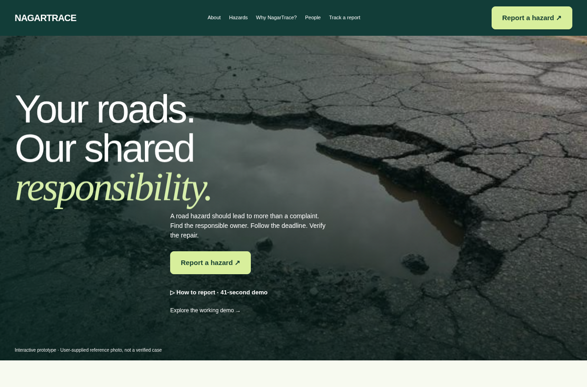
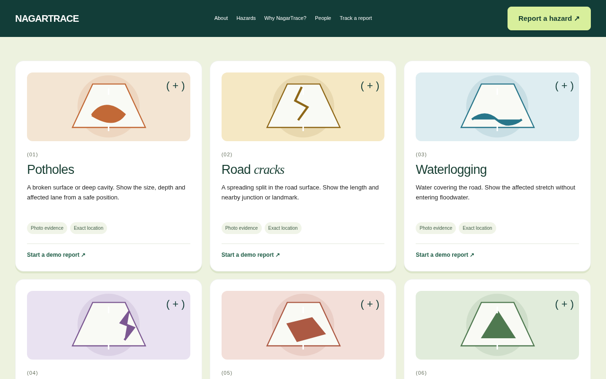
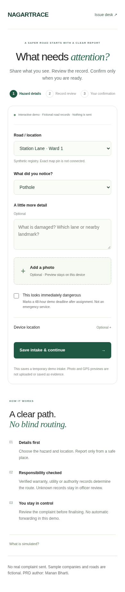
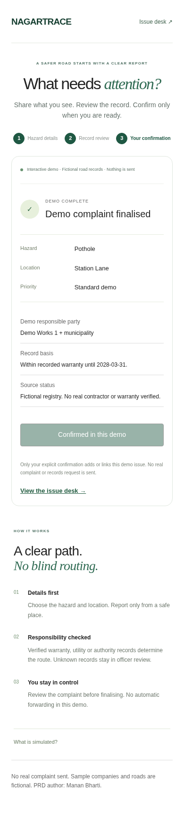
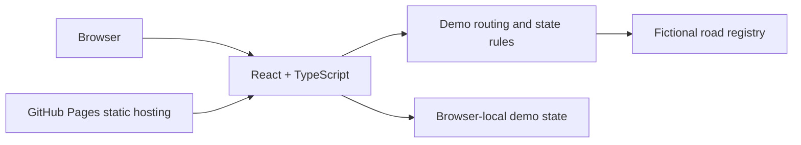

# NagarTrace

### Your roads. Our shared responsibility.

An interactive road-hazard accountability prototype: describe a hazard, check the road record, review responsibility and confirm a demo complaint.

[Open the live demo](https://khuranacode.github.io/NagarTrace/) · [Source](https://github.com/KhuranaCode/NagarTrace)

> This public website uses fictional roads, companies, warranties and identities. It sends no real complaint. It is not an emergency service. AI detection and authority delivery are not implemented.



## Try it

1. Select **Report a hazard**.
2. Choose a sample road and hazard. Add an optional note.
3. Save a temporary demo intake.
4. Use **Simulate record review** to inspect a fictional responsibility record.
5. Review the proposed route and explicitly finalise the demo complaint.
6. Explore the issue desk and synthetic road registry.

Photo and device-location previews stay on your device. They are not uploaded as evidence. The report screen resets on refresh; browser-local demo issues are not a shared database.

## The idea

A road complaint needs more than a submission receipt. NagarTrace explores a chain from hazard to responsible owner, a visible deadline and a repair that can be checked. Verified utility work takes priority; warranty and municipal routing depend on verified records. Unknown records should go to officer review, not a guessed contractor.



| Intake | Explicit final check |
| --- | --- |
|  |  |

## What works today

- Responsive landing, high-contrast report buttons, hazard guidance and mobile navigation.
- Captioned 41-second How to report video embedded on the website.
- Three-step simulated reporting flow with edit and final confirmation.
- Issue desk, filters, search and 20 synthetic road records.
- Demo routing, deadlines, repair-proof and confirmation state-machine rules.
- 19 automated engine tests.
- GitHub Pages deployment, with hash routes for refresh-safe static hosting.

## Architecture: current public demo



There is no deployed backend behind this website. Separate backend groundwork has been tested locally with PostgreSQL/PostGIS and signed test JWTs. It is not integrated into this public demo.

## Run locally

Node.js 22.12+ is required.

```sh
npm ci
npm run dev
npm test
npm run build
```

The active source is under `src/src/`; `index.html` points to its entry. `npm run build` uses the `/NagarTrace/` Pages base. Routes use `#/report`, `#/desk`, `#/registry` and `#/about`. The Pages workflow builds and publishes `dist/`.

Root `source-part-*.txt` and `restore.mjs` preserve an earlier source backup. They are not needed for the current checkout.

## Production gates still open

| Area | Current status |
| --- | --- |
| Accounts and saved reports | Local backend foundation tested; hosted service and UI integration pending |
| Exact map pins | Not connected in public demo |
| Secure photo uploads | Local previews only; validation, privacy review and private storage pending |
| Road/contractor/warranty data | Fictional records; verified datasets and authority process required |
| Repair tracking and escalation | Demo rules only; real workflow and delivery pending |
| AI hazard detection | Not implemented or evaluated |
| Privacy and security | Partial local tests; deployment review, broader security and real-user testing required |

A clean dependency scan is not a security certification. Never place real sensitive reports, credentials or personal data into this demo.

## Images and credits

Supplied photos illustrate the prototype; they are not verified cases or repair evidence. Location and date are unverified. Compressed copies are included with the owner's approval; originals remain unchanged privately.

Design direction: [Nova Dental](https://nova-dental-dev.webflow.io/). No reference-site code, fonts or assets copied. PRD attribution: Manan Bharti.
