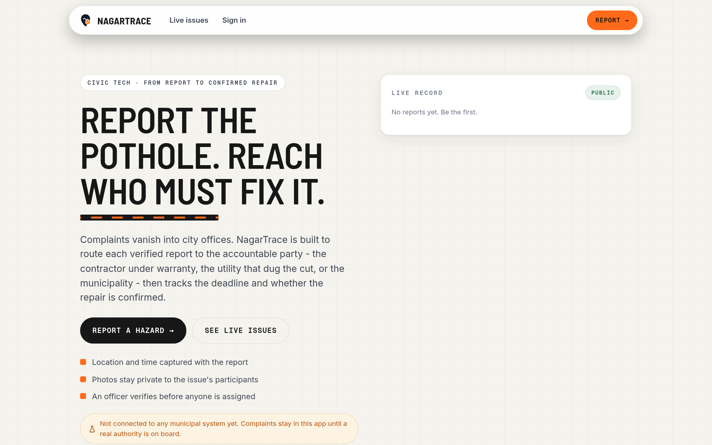
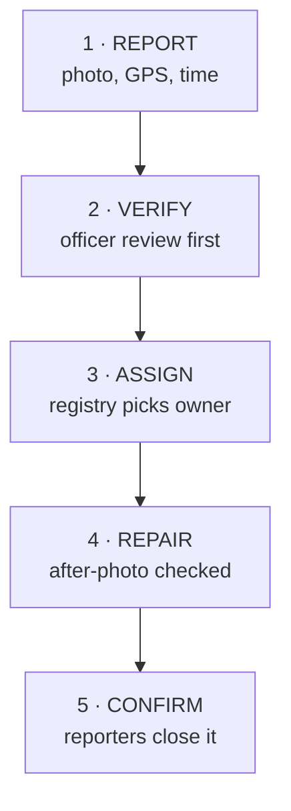
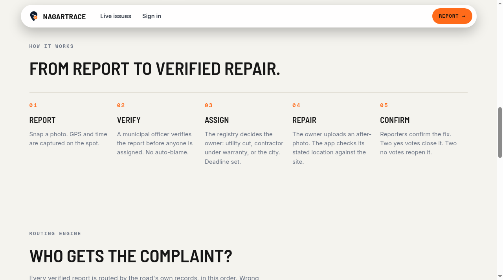
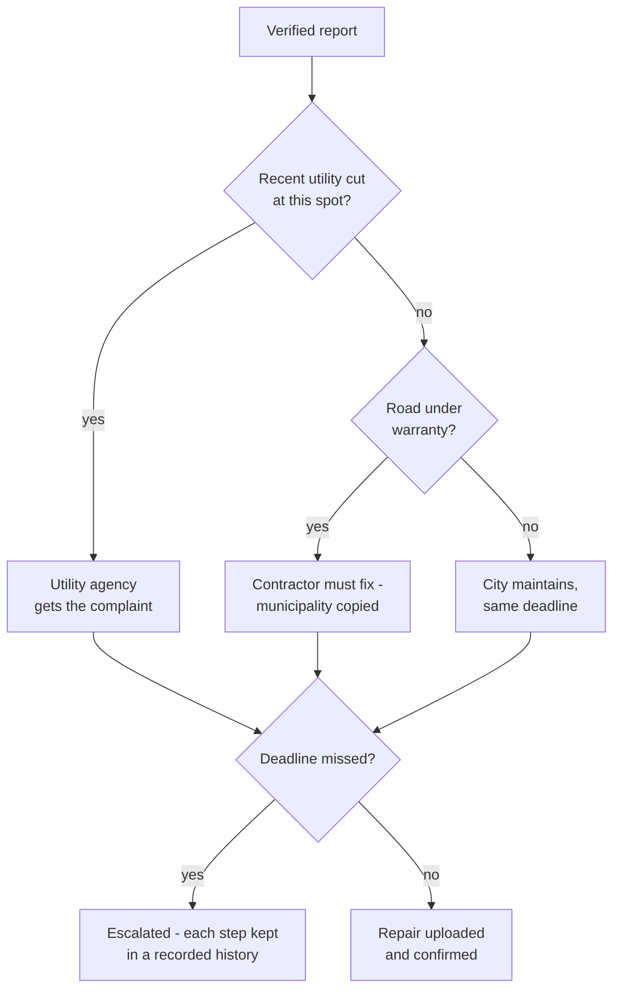
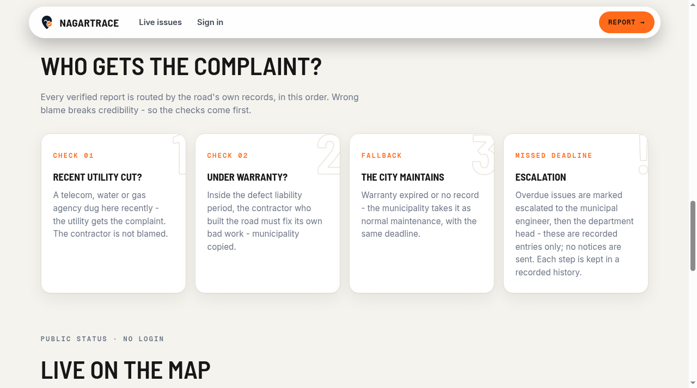
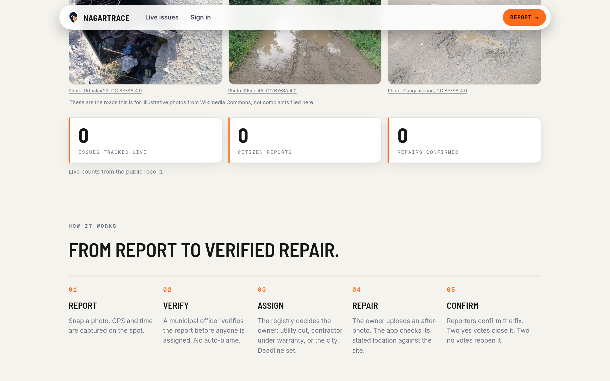
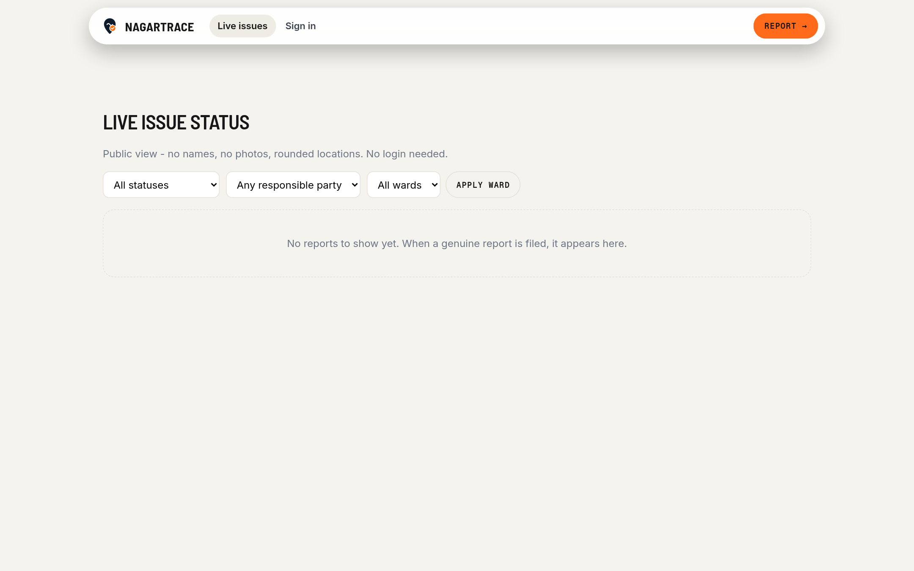
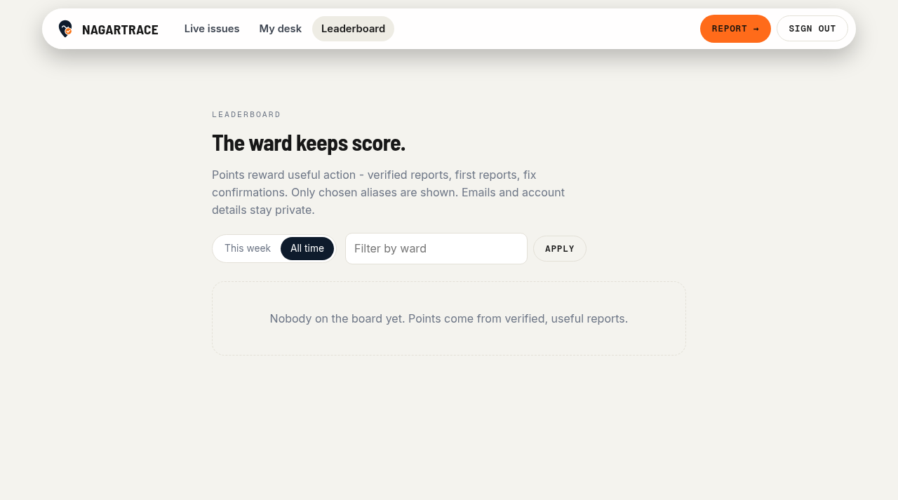
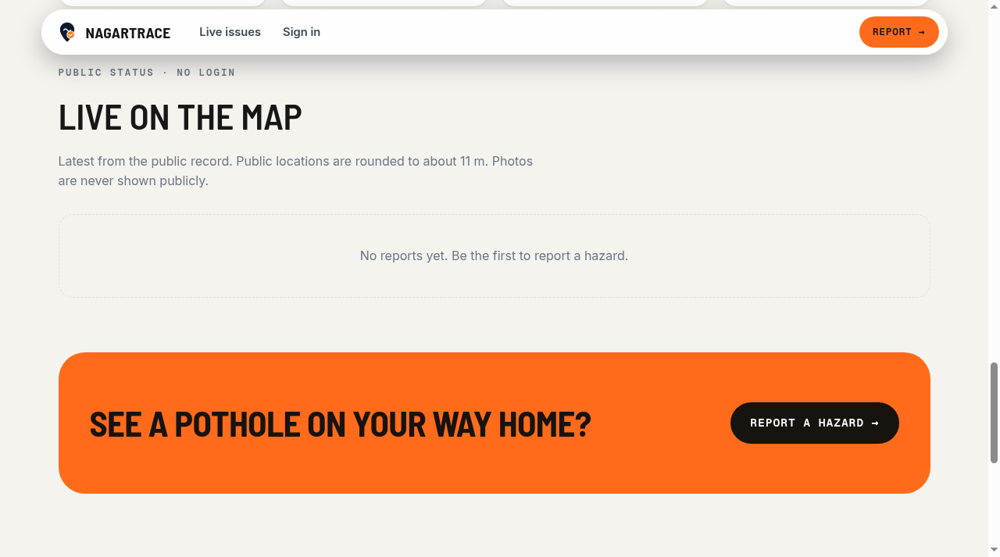

<p align="center">
  
</p>

<h1 align="center">NagarTrace</h1>

<p align="center">
  <strong>From a road hazard to a repair you can verify.</strong><br/>
  Citizens report a pothole. NagarTrace works out who must fix it, sets the deadline, and tracks the repair until citizens confirm it.
</p>

<p align="center">
  <a href="https://khuranacode.github.io/NagarTrace/"><strong>Live demo</strong></a> ·
  <a href="https://github.com/KhuranaCode/nagartrace-api">Backend API</a> ·
  <a href="#screenshots">Screenshots</a> ·
  <a href="#roadmap">Roadmap</a>
</p>

<p align="center">
  
  
  
  
</p>

<p align="center">
  
</p>

> **Status: pre-release prototype, built for Zinnovatio 4.0.** Not connected to any municipal system yet - complaints stay in this app until a real authority is on board. The road/contractor/warranty registry behind routing currently holds synthetic test data only. Not an emergency service.

---

## The idea

A report that only says *what* is broken is easy to file away. NagarTrace is built to answer three harder questions about every road hazard: **who** is responsible for the fix, **when** it must be done, and **whether** the repair actually happened - verified, not just claimed.

## How it works



<p align="center">
  
</p>

## The routing engine - who gets the complaint?

Every verified report is routed by the road's own records. Wrong blame breaks credibility, so the checks come first:



<p align="center">
  
</p>

*This is the proposed operational workflow as implemented. The registry it reads today is synthetic test data - no real municipality, utility or contractor is connected, and a genuine report that matches no registry entry stays unassigned until an authority is onboard. It is never sent to a real office.*

## Screenshots

<table>
  <tr>
    <td></td>
    <td></td>
  </tr>
  <tr>
    <td align="center"><strong>Live public record</strong> - counts straight from the API</td>
    <td align="center"><strong>Public issue board</strong> - no names, no photos, rounded locations</td>
  </tr>
  <tr>
    <td></td>
    <td></td>
  </tr>
  <tr>
    <td align="center"><strong>Ward leaderboard</strong> - aliases only, account details stay private</td>
    <td align="center"><strong>Live on the map</strong> - public pins rounded to about 11 m</td>
  </tr>
</table>

*Screenshots from the live deployment. The public record currently shows zero genuine reports.*

## Working today

Implemented and tested, with limits noted:

- **Live web app** on GitHub Pages backed by a hosted API - the public record is read from the live backend, not baked into the page.
- **Public issue status board** - anyone can check status without an account; public views show no names, no photos and locations rounded to about 11 m.
- **Accounts with email + password** - sign-up with email confirmation is implemented; email delivery is subject to provider limits. The Google sign-in button is currently disabled: the OAuth flow is implemented and tested with the owner's account, and stays limited until the consent screen is configured and published and a non-owner sign-in is tested.
- **Report flow** - photo, GPS and time capture with private photo evidence, exercised end-to-end with synthetic test accounts.
- **Officer-review configuration** - the running mode keeps routing as a suggestion until an officer verifies. So far this has only been exercised on synthetic data; no municipal officer is onboard.
- **Citizen dashboard and ward leaderboard** - aliases only on the board; account details stay private.
- **Backend test suite** - 61 automated tests passing against local PostgreSQL + PostGIS.
- **Data separation** - existing test fixtures are excluded from public views; live checks after the separation confirmed the public board and API show genuine records only.

## Roadmap

Proposed, not built yet - in priority order:

- **Municipal onboarding** - connect a real authority so verified complaints actually reach an office (one-ward pilot first).
- **Real registry** - road, contractor and warranty records sourced from authorities, replacing the synthetic test registry.
- **Google sign-in for everyone** - implemented and tested with the owner's account; general availability is pending consent-screen configuration, publication and a non-owner sign-in test.
- **Escalation notices** - overdue entries are recorded today; actually notifying officers is next.
- **AI assist** - hazard classification, duplicate detection, automatic face/plate blurring.
- **Notifications and public ward scorecards.**

## Privacy and trust

- Photos are private to an issue's participants - never shown publicly.
- Public locations are rounded to about 11 m.
- No auto-blame: verification comes before any party is assigned.
- Leaderboard shows chosen aliases only.
- Public client config (API URL, Supabase URL, publishable key) lives in `src/config.ts`.

## Tech stack

| Layer | Choice |
| --- | --- |
| Frontend | React 19 + TypeScript + Vite, React Router, Leaflet + OpenStreetMap |
| Backend | Node 22 + Fastify 5 ([`KhuranaCode/nagartrace-api`](https://github.com/KhuranaCode/nagartrace-api)) |
| Database | PostgreSQL + PostGIS (Supabase) |
| Auth | Supabase Auth (email + password; Google OAuth configured, off) |
| Hosting | GitHub Pages (web) + Render (API) |

## Run locally

```bash
npm ci
npm run dev        # http://localhost:3000
npm run typecheck
npm run build
```

## Team

Built by **Team Grexars** for Zinnovatio 4.0 - Aaditya (app), Manan (web), Ojasvi (design & pitch), Prachi (testing), Saksham (presentation & content).

## Photo credits

Illustrative road photos on the home page are from Wikimedia Commons (CC BY-SA 4.0): Rrthakur22, KEmel49, Gangaasoonu. They show the roads this is for - they are not complaints filed here.
